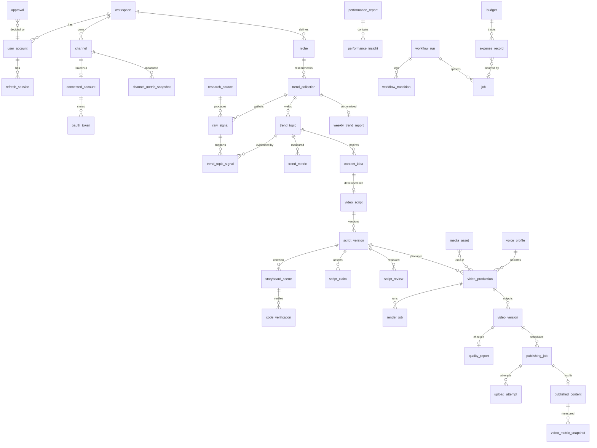

# Database Design (first pass)

**Version:** 0.1 (Phase 00) · **Date:** 2026-11-14 · **Owner:** database-engineer
**Engine:** PostgreSQL 16+ · **ORM:** TypeORM with explicit migrations (no `synchronize` outside unit tests)

## 1. Conventions
- Table names `snake_case` singular; PK `id uuid` (UUIDv7 generated in the app for index locality).
- Every table has `created_at timestamptz not null default now()` and `updated_at timestamptz` (except append-only tables).
- `workspace_id` on every domain table (single workspace in MVP; ready for multi-workspace).
- Money: `amount_minor bigint` + `currency char(3)`. No floats.
- Enums as Postgres `text` + `CHECK` constraints (easier migrations than native enums).
- Provider payloads in `jsonb` columns named `raw` or `params`, never used for core querying.
- Soft delete only where user data is involved (`deleted_at`); audit tables are append-only (`UPDATE`/`DELETE` revoked from the app role).
- Every migration is reversible (`down` implemented), tested against a disposable DB in CI.

## 2. Domains
| # | Domain | Tables |
|---|---|---|
| 1 | Identity & workspace | `workspace`, `user_account`, `refresh_session` |
| 2 | Channels & integrations | `channel`, `connected_account`, `oauth_token` |
| 3 | Niches & research | `niche`, `research_source`, `trend_collection`, `raw_signal`, `trend_topic`, `trend_topic_signal`, `trend_metric`, `weekly_trend_report` |
| 4 | Ideas, scripts, review | `content_idea`, `video_script`, `script_version`, `storyboard_scene`, `script_claim`, `code_verification`, `script_review` |
| 5 | Media & production | `media_asset`, `voice_profile`, `video_production`, `render_job`, `video_version`, `quality_report` |
| 6 | Publishing | `publishing_job`, `upload_attempt`, `published_content`, `publishing_log` |
| 7 | Analytics | `video_metric_snapshot`, `channel_metric_snapshot`, `performance_report`, `performance_insight`, `content_experiment` |
| 8 | Finance | `expense_record`, `revenue_record`, `budget`, `monetization_status` |
| 9 | Workflow & audit | `workflow_run`, `workflow_transition`, `job`, `approval`, `audit_event`, `notification` |

## 3. ERD (first pass)

## 4. Key tables (columns abridged)
| Table | Important columns | Constraints / indexes |
|---|---|---|
| `user_account` | email (citext), password_hash (argon2id), role, mfa_secret_enc, last_login_at | unique(workspace_id, email) |
| `connected_account` | provider ('youtube'), external_account_id, channel_title, scopes text[], status, connected_by | unique(workspace_id, provider, external_account_id) |
| `oauth_token` | connected_account_id, access_token_enc, refresh_token_enc, key_version, expires_at, revoked_at | Envelope-encrypted (see `SECURITY_DESIGN.md`); never selected by default |
| `research_source` | key, type (api/rss), base_url, terms_verified_at, terms_notes, enabled, rate_limit | unique(key) |
| `raw_signal` | source_id, collection_id, external_id, url, title, metrics jsonb, retrieved_at, content_hash | unique(source_id, external_id, collection_id); index(content_hash) |
| `trend_topic` | collection_id, canonical_title, slug, score numeric(5,4), score_breakdown jsonb, confidence, missing_components text[], status (new/approved/rejected) | unique(collection_id, slug) |
| `trend_metric` | topic_id, name, value numeric, unit, source_id, observed_at, retrieved_at | Every metric row has a source and timestamps (provenance) |
| `content_idea` | topic_id, title, hook, angle, audience, value_prop, format, target_duration_s, source_refs jsonb, embedding vector(1024)?, similarity_flag | index ivfflat(embedding) once pgvector is enabled |
| `script_version` | script_id, version int, author_type (ai/human), llm_prompt_ref, llm_model, body jsonb, word_count, est_duration_s, status | unique(script_id, version); versions immutable after creation |
| `script_claim` | script_version_id, text, source_ref, verdict (supported/unsupported/contradicted/overridden), evidence, override_reason | |
| `code_verification` | scene_id, language, code_hash, result (pass/fail/error), stdout, stderr, runtime_ms | |
| `media_asset` | kind (image/audio/font/music/code_frame/video), storage_key, sha256, mime, bytes, **source**, **creator_or_provider**, **license**, **license_url**, **usage_rights**, generation_params jsonb, provenance jsonb | unique(sha256, kind); license NOT NULL |
| `video_version` | production_id, version, storage_key, sha256, width, height, fps, duration_ms, codec, bitrate, captions_key | unique(production_id, version) |
| `quality_report` | video_version_id, checks jsonb, passed bool, failures text[] | |
| `publishing_job` | video_version_id, channel_id, privacy (private/unlisted/public), publish_at, title, description, tags, contains_synthetic_media, made_for_kids, approval_id, status, idempotency_marker | **unique(video_version_id, channel_id)**; approval_id NOT NULL before status ≥ 'approved' |
| `upload_attempt` | publishing_job_id, attempt_no, state (started/succeeded/failed/unknown), remote_video_id, request_hash, response_summary, started_at, finished_at | unique(publishing_job_id, attempt_no) |
| `published_content` | publishing_job_id, remote_video_id, url, remote_privacy, upload_status, verified_at | **unique(remote_video_id)**; unique(publishing_job_id) |
| `video_metric_snapshot` | published_content_id, metric, value, window_start, window_end, source_api, fetched_at, is_estimated, is_delayed | unique(published_content_id, metric, window_start, window_end, fetched_at) |
| `expense_record` | provider, category (llm/tts/image/render/storage/hosting/other), units, unit, unit_price_version, amount_minor, currency, related_type, related_id, job_id, occurred_at | index(occurred_at), index(provider) |
| `revenue_record` | source (youtube_import/affiliate/sponsorship/manual), amount_minor, currency, period_start, period_end, is_estimated, evidence_ref | |
| `budget` | scope (global/provider/video), period (day/week/month), limit_minor, currency, warn_pct, action ('pause') | |
| `job` | type, queue, idempotency_key, status, attempt, max_attempts, progress, input jsonb, output_ref, error jsonb, correlation_id, lease_until, workflow_run_id | **unique(idempotency_key)**; index(status, queue) |
| `approval` | subject_type, subject_id, subject_version_hash, decision, decided_by, note, decided_at | Approval is bound to the exact content hash; any edit invalidates it |
| `audit_event` | occurred_at, actor_type (user/system/worker), actor_id, action, subject_type, subject_id, correlation_id, ip, details jsonb (redacted) | Append-only; BRIN(occurred_at) |

## 5. Integrity rules enforced in the DB
- No publishing job can reach `approved`/`uploading` without an `approval` row whose `subject_version_hash` matches the video version's sha256 (enforced by service + check trigger).
- `published_content.remote_video_id` is unique, so a recorded duplicate upload is impossible.
- `media_asset.license` is NOT NULL, so an asset without rights metadata cannot be stored.
- `trend_metric.source_id`, `observed_at`, and `retrieved_at` are NOT NULL, so no metric lacks provenance.
- `script_version` rows are immutable (an update trigger rejects changes to `body` after insert).

## 6. Retention and privacy
- Raw provider payloads (`raw` jsonb) are kept 90 days, then nulled by a maintenance job.
- Audit events are kept ≥ 1 year.
- OAuth tokens are deleted on disconnect, and revocation is also called at Google.
- No end-viewer personal data is stored (analytics are aggregate only).

## 7. Migration strategy
- One migration per change set; naming `YYYYMMDDHHMM-description.ts`.
- CI: run all migrations up on an empty DB, then all down, then up again.
- Production: back up before migrating; never use destructive changes without a two-step (expand → migrate data → contract) plan.
