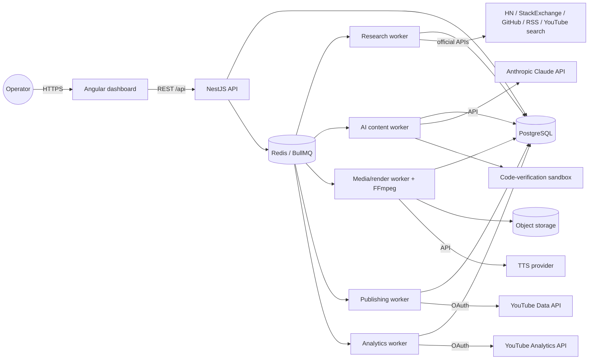

# System Architecture

**Version:** 0.1 (Phase 00) · **Date:** 2026-11-14 · **Owners:** backend-engineer (application), devops-engineer (deployment)

## 1. Architecture goals
1. **Correctness over throughput:** low volume (3–5 videos/week, hard cap 5), high quality, zero accidental public uploads.
2. **Durable, idempotent jobs:** every long step is a persisted job that can be retried or resumed after a crash.
3. **Provider independence:** AI, TTS, storage, and social platforms sit behind interfaces with mock implementations for tests and CI.
4. **Auditability:** every external side effect and human approval is recorded.
5. **Cheap to run:** fits on one small VM; scales by adding worker containers.

## 2. Context diagram


## 3. Technology choices and trade-offs
| Concern | Choice | Alternatives considered | Why |
|---|---|---|---|
| Frontend | **Angular (latest LTS), standalone components, signals, Angular Material** | React, server-rendered NestJS views | Operator's core stack; strong forms for script editing |
| Backend | **NestJS + TypeScript (strict)** | Express, Fastify-only | Modules/DI suit many domains; first-class BullMQ, TypeORM, Swagger |
| Database | **PostgreSQL 16+ with TypeORM migrations** | MongoDB, MySQL | Relational workflow state, constraints, JSONB for provider payloads; `pgvector` available for idea dedup |
| Queue | **Redis + BullMQ** | Postgres-only queue (pg-boss), Temporal | Mature retries/backoff/priorities/flows; Temporal is overkill at MVP scale. Durable state is in Postgres, so Redis loss is recoverable |
| Workflow orchestration | **DB state machine + BullMQ flows** | Temporal, AWS Step Functions | Keeps the stack small; Postgres is the source of truth for workflow state (see §6) |
| Rendering | **FFmpeg CLI** in a worker container; code frames rendered to PNG via **Shiki** (syntax highlighting) + **Satori/resvg** or headless Chromium | Remotion, cloud render APIs | Deterministic, free, scriptable. Remotion licensing and its React dependency are unnecessary |
| Storage | **S3-compatible API** (SeaweedFS locally; S3 or an S3-compatible store in cloud) | Local disk | Same code in every environment; signed URLs for preview |
| Code verification | **Separate sandbox-runner service** starting ephemeral gVisor/rootless containers (workers never get `docker.sock`) with no network, CPU/memory/time limits, read-only FS except `/tmp` | Remote sandbox services | Runs untrusted LLM-written code safely; supports node/ts/python/sql (via SQLite/pg-in-container) |
| Auth | **Local accounts, argon2id, short-lived JWT access + rotating refresh cookie; TOTP MFA in Phase 09** | External IdP | Single operator; no third-party dependency. OAuth to Google is only for *integrations*, not app login |
| API style | **REST + OpenAPI (Swagger)**, server-sent events for job progress | GraphQL, WebSockets | Simple; SSE is enough for one-way progress |
| Monorepo | **npm workspaces** (or Nx if build caching is needed) with `apps/api`, `apps/web`, `apps/worker`, `libs/contracts` | Separate repos | Shared DTO/contract types between API and UI |

## 4. Repository layout (target for Phase 01)
```
apps/
  api/          NestJS HTTP API (modules below)
  worker/       NestJS standalone app hosting BullMQ processors (one image, per-queue concurrency via env)
  web/          Angular dashboard
libs/
  contracts/    Shared TS types, zod/class-validator DTO schemas, enums, event names
  providers/    Provider interfaces + adapters + mocks (llm, tts, storage, social, research)
infra/
  docker/       Dockerfiles; compose.yaml (postgres, redis, minio, api, worker, web)
  ci/           GitHub Actions workflows
docs/  phases/  tasks/
```

## 5. Backend modules (NestJS)
| Module | Responsibility | Phase |
|---|---|---|
| `config` | Typed env validation (fail fast), feature flags | 01 |
| `health` | Liveness, readiness (DB, Redis, storage) | 01 |
| `auth`, `users` | Login, JWT, refresh rotation, roles (`owner`, `reviewer`) | 01 |
| `audit` | Append-only audit events; interceptor for mutating routes | 01 |
| `channels`, `integrations` | Channel config; OAuth connections with encrypted tokens | 01 / 05 |
| `jobs` | Job records, progress, cancellation, dead-letter view | 01 |
| `research` | Niches, sources, collections, topics, metrics, scoring, weekly report | 02 |
| `content` | Ideas, scripts, versions, storyboards, reviews, verification, fact-check | 03 |
| `media` | Assets, voice profiles, productions, renders, quality reports | 04 |
| `publishing` | Schedules, publishing jobs, upload attempts, remote verification | 05 |
| `analytics` | Metric snapshots, reports, experiments, insights | 06 |
| `finance` | Expense/revenue ledger, budgets, budget guard | 07 (ledger + budget guard from 02) |
| `workflow` | End-to-end workflow state machine, approval gates, autopilot policy | 08 |
| `notifications` | In-app notifications, optional email | 08 |

## 6. Job and workflow design
- **Queues:** `research`, `content`, `verify`, `media`, `render`, `publish`, `analytics`, `maintenance`. Concurrency is configured per queue (`render`: 1 per CPU core pair; `publish`: 1).
- **Job record in Postgres** (`job` table) is the source of truth: `id`, `type`, `idempotency_key` (unique), `status`, `attempt`, `progress`, `input`, `output_ref`, `error`, `correlation_id`, timestamps. The BullMQ job ID is the Postgres job ID.
- **Idempotency:** each job derives a deterministic key (for example, `render:{videoVersionId}`, `upload:{videoVersionId}:{channelId}`). Creating a job with an existing key returns the existing job.
- **Retries:** exponential backoff with jitter. Error classes: `retryable` (network, 429, 5xx), `non_retryable` (validation, 4xx policy), `needs_human` (uncertain upload state, policy flag).
- **External side effects** (upload, email) use a **two-phase pattern**: record an `upload_attempt` as `started` → call the API → record the result. On restart, any attempt left `started` is **never blindly retried**. The worker first queries YouTube for a video carrying our idempotency marker (see §8) and reconciles.
- **Cancellation:** a cooperative flag checked between steps; FFmpeg child processes are killed on cancel.
- **Recovery:** on worker boot, a reconciler re-enqueues `queued`/`running` jobs whose lease has expired.
- **Dead letter:** after max attempts the job status becomes `failed` with a visible reason; workflows move to `needs_attention`.
- **Workflow state machine (Phase 08):** `research → ideas → script_draft → script_approved → producing → video_ready → video_approved → scheduled → published → measuring`, plus `paused_budget`, `needs_attention`, `cancelled`. Transitions are validated server-side; approval transitions require an authenticated human action and cannot be triggered by workers.

## 7. Media pipeline (Phase 04 detail)
1. **Storyboard → scene specs** (duration, narration, code block, highlight lines, caption text).
2. **Code frames:** Shiki → HTML/SVG → PNG at 1080×1920, a minimum 28 px code font, line highlighting, typing animation via frame sequences.
3. **Narration:** TTS per scene → WAV. Measure duration and fit scene length to audio.
4. **Audio:** loudness normalize to −14 LUFS (FFmpeg `loudnorm`). Optional licensed music bed at −28 dB under voice.
5. **Captions:** word timing from TTS timestamps (when the provider supports it) or forced alignment. SRT + burned-in ASS subtitles inside the safe area.
6. **Composition:** FFmpeg filter graph → H.264 High, yuv420p, 30 fps default, AAC 48 kHz, `+faststart`.
7. **Quality checks:** `ffprobe` (resolution, duration ≤ 60 s target / ≤ 180 s hard limit, A/V stream presence, sync drift), loudness, caption bounds, missing assets. Produces a `QualityReport`.
8. **Preview:** signed URL from storage; the operator reviews and approves.

## 8. Publishing safety design (Phase 05 detail)
- Always send `status.privacyStatus` (default `private`), `selfDeclaredMadeForKids=false`, and `containsSyntheticMedia` per policy.
- Scheduling: upload as `private` + `publishAt`. **A scheduled upload is treated as a public publish**, because YouTube makes it public automatically, so it needs the owner-only public approval (see `SECURITY_DESIGN.md` §6). Public-now uploads need the same.
- **Duplicate prevention:** a unique DB constraint on `(video_version_id, channel_id)` in `published_content`, plus an idempotency marker (a short hash) stored in the video's description footer. Before any retry, list recent uploads via the channel's **uploads playlist** (`channels.list` → `contentDetails.relatedPlaylists.uploads` → `playlistItems.list`, then `videos.list`) and match the marker. Don't use `search.list forMine`: it spends search quota and may not index fresh private videos. This needs `youtube.readonly` in Phase 05.
- Verify `uploadStatus`/`processingDetails` after upload. Mark published only once the remote state is confirmed.

## 9. Deployment architecture
### Local / CI
Docker Compose: `postgres`, `redis`, `minio`, `api`, `worker`, `web` (dev server or nginx). CI runs unit + integration tests against service containers with all providers mocked.

### Cloud options (decision deferred to Phase 09, per approved plan)
| Criterion | **AWS** | **Azure** |
|---|---|---|
| MVP shape | 1× EC2 `t4g.medium`/`t3.medium` running Compose, or Lightsail; S3; optional RDS later | 1× B2s/B2ms VM running Compose, or Container Apps; Blob Storage; optional Flexible Server later |
| Managed Postgres (later) | RDS / Aurora Serverless v2 | Azure Database for PostgreSQL Flexible |
| Containers at scale | ECS Fargate | Azure Container Apps (scale-to-zero suits bursty render work) |
| Secrets | Secrets Manager / SSM Parameter Store | Key Vault |
| Rough MVP infra cost | $15–60/mo [A] | $15–60/mo [A] |
| Notes | Broadest ecosystem; Graviton is cheap for workers (FFmpeg arm64 works) | Container Apps jobs are a good fit for render workers |
**Recommendation:** start with **one VM running Docker Compose** + managed object storage + nightly `pg_dump` backups to object storage. Choose the provider where the operator already has an account and credits. Move to managed Postgres and container services only when volume or reliability needs justify the cost. The final decision and IaC (Terraform) come in Phase 09.

## 10. Observability
- Structured JSON logs (pino) with `correlation_id`, `job_id`, `workflow_id`; secrets redacted by logger config.
- Metrics: Prometheus endpoint (job durations, failures, queue depth, provider latency/cost); Grafana or cloud-native dashboards in Phase 09.
- Tracing: OpenTelemetry instrumentation for HTTP, BullMQ, and provider calls (Phase 09).
- The UI job monitor shows status, progress, and errors for every job.

## 11. Non-functional requirements
| NFR | Target |
|---|---|
| API p95 latency (CRUD) | < 300 ms locally |
| Render time for a 60 s Short | < 5 min on 2 vCPU |
| RPO / RTO (production) | 24 h / 4 h (nightly backup; documented restore) |
| Availability | Best effort (single VM); no SLA for an internal tool |
| Security | See `SECURITY_DESIGN.md` |

## 12. Phase 01 implementation decisions (2026-11-15)
Recorded deviations and refinements from the Phase 00 design:
| Topic | Phase 00 design | Implemented | Reason |
|---|---|---|---|
| Worker | Separate `apps/worker` app | Second entrypoint `apps/api/src/worker.ts` (same codebase and image, separate process) | Shares entities and services without a third package; scales independently |
| Local object storage | MinIO | SeaweedFS (S3 API) | MinIO no longer publishes container images; app uses the standard S3 API, so production can use S3 or another S3-compatible store |
| Local ports | Defaults | Postgres 55432, Redis 56379, API 3100 | Avoid clashing with other local projects |
| Runtime | Node LTS | Node 24.22.3, TypeScript 6.0, NestJS 12 (ESM packages), Angular 22, TypeORM 0.3.31 | Current supported versions; TypeORM 1.x was 2 days old at the time |
| Access token signing | EdDSA | HS256 with ≥32-char secret, issuer/audience checked | Simpler for the MVP's single service; revisit in Phase 09 |
| IDs | App-generated UUIDv7 | `gen_random_uuid()` (v4) | Postgres 17 lacks native v7; revisit if index locality matters |
| Queue isolation | n/a | `QUEUE_PREFIX` per environment | Dev and test workers sharing one Redis must not consume each other's jobs |
| Rate limiting | Login limits | 120 req/min global, 5/min login, 30/min refresh; `THROTTLE_ENABLED` must stay true in production | |

## 13. Phase 04 implementation decisions (2026-11-15)
| Topic | Phase 00 design (§7) | Implemented | Reason |
|---|---|---|---|
| Code frames | Shiki → HTML → PNG, typing animation | Own SVG layout (monospace metrics) + minimal highlighter → PNG via resvg (`@resvg/resvg-js`) with bundled JetBrains Mono (OFL); static frames per caption cue | No headless browser in the worker; deterministic, content-addressed frames; exact caption bounds from monospace metrics. Typing animation deferred |
| Captions | TTS word timings / forced alignment, burned-in ASS | Cues timed proportionally to text length across the measured speech; burned into frames (safe area 90–950 × 1190–1440 at 1080×1920) + WebVTT sidecar | No libass dependency; word timings arrive with a production TTS provider |
| Narration | Cloud TTS | `TtsProvider` interface; local eSpeak NG (draft voice, flagged by QC) and a mock tone (tests; fails QC). Cloud TTS = user decision (new integration) | Pipeline is fully testable without credentials |
| Transitions | Per storyboard | Cuts, plus fade-in/out of the whole video. `fade`/`slide`/`zoom` are recorded and reported as a QC warning | v1 scope |
| Render jobs | `render_job` table | Rows in `job` (type `video.render`) on a dedicated `render` queue; `video_production.job_id` points to the current attempt | Reuses lease/heartbeat/reconcile machinery |
| Idempotency | — | Production unique per (script version, settings hash, voice); assets unique per (workspace, kind, sha256) with input cache keys; one `video_version` per (production, job) | Retries and duplicate requests never duplicate records or regenerate finished assets |
| Cancellation | — | `cancel_requested` flag; the render poll (2 s) aborts the pipeline and SIGKILLs FFmpeg/TTS children | Bounded stop time |
| Preview | Presigned storage URL | API-signed (HMAC, HKDF-derived key, 15 min) `/api/video/media/:id` with HTTP Range, streamed from storage | Storage is not exposed publicly; works behind nginx |
| Music | Optional licensed bed | Not used (no licensed music source yet) | Rights first |

